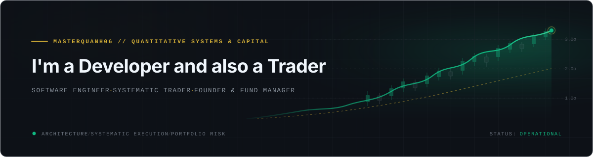

  

  Engineering resilient software architecture alongside systematic trading strategies and disciplined private capital management.

---

### Core Focus

<table>
  <tr>
    <th align="left" width="50%">Engineering &amp; Systems</th>
    <th align="left" width="50%">Trading &amp; Capital Management</th>
  </tr>
  <tr>
    <td valign="top">
      <ul>
        <li>Full-stack architecture with <strong>NestJS</strong>, <strong>React</strong>, and <strong>PostgreSQL</strong></li>
        <li>Automated trading bots, execution pipelines &amp; low-latency APIs</li>
        <li>Market telemetry, trade analytics &amp; internal journaling systems</li>
      </ul>
    </td>
    <td valign="top">
      <ul>
        <li>Systematic execution frameworks &amp; rule-based risk models</li>
        <li>Macroeconomic research &amp; institutional market structure analysis</li>
        <li>Portfolio allocation, drawdown control &amp; private fund operations</li>
      </ul>
    </td>
  </tr>
</table>

---

### Tech Stack & Trading Infrastructure

**Backend & Data**

  
  
  
  
  
  
  
  

**Frontend & UI**

  
  
  
  

**Quant & Trading**

  
  
  
  

---

### Market & Coding Activity

  

---

### Connect

  
  
  
  

